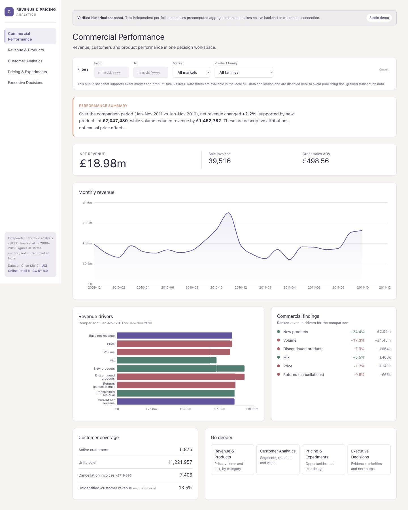
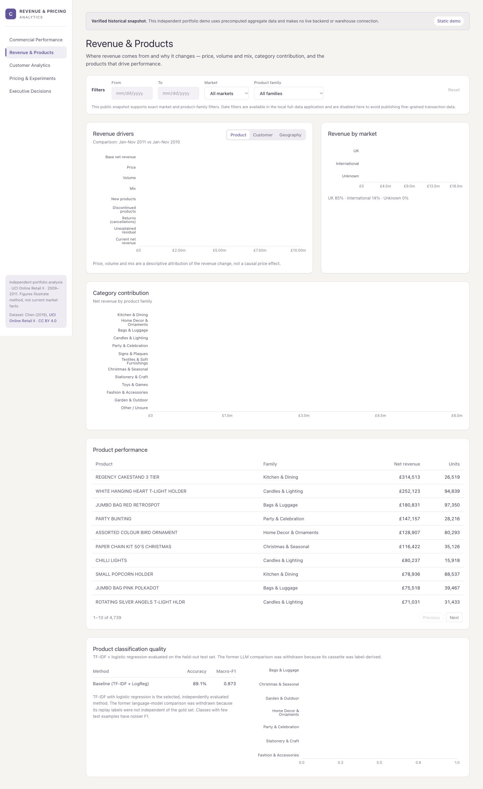
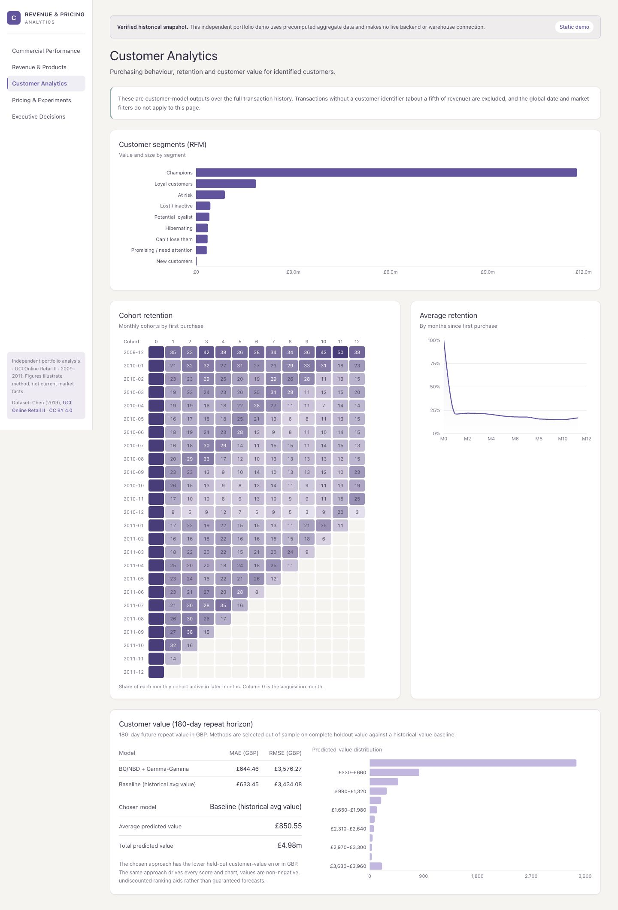
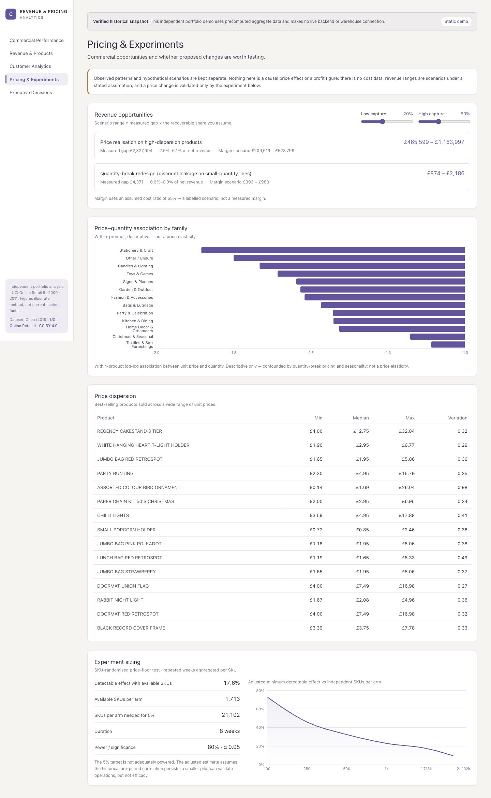
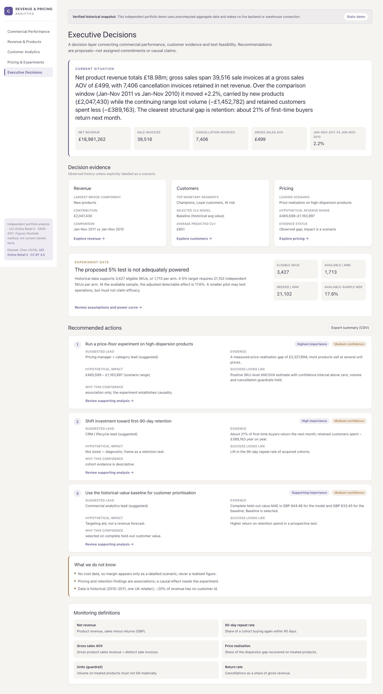
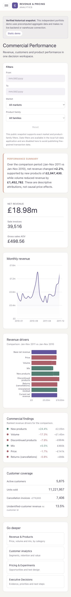
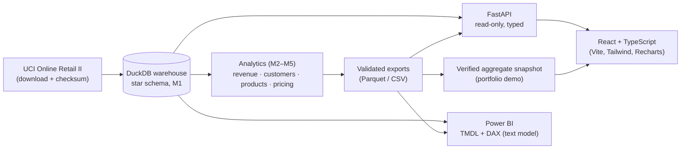

# Revenue & Pricing Analytics

**Commercial Performance — revenue, customers and products in one decision workspace.**

- **Live demo:** <https://commercial-pricing-intelligence.vercel.app/>
- **Source:** <https://github.com/sohamshindework/commercial-pricing-intelligence>

An end-to-end commercial analytics platform that turns raw transaction data into
reconciled revenue decomposition, customer-value models, an evaluated product
taxonomy, pricing-opportunity scenarios and a designed pricing experiment — then
presents it all in an interactive React application backed by a typed FastAPI
service over a DuckDB warehouse. A separate verified static mode provides the same
five-route portfolio experience from precomputed aggregate JSON, with no public
backend or warehouse.

Every figure shown in the app is produced by a tested Python pipeline. Nothing in
the interface is hand-typed, fabricated or recomputed in the browser.

| Validated measure | Result |
|---|---:|
| Source / retained transactions | 1,067,371 / 1,033,062 |
| Net product revenue | £18,981,261.52 |
| Sale / cancellation invoices | 39,516 / 7,406 |
| Gross sales AOV | £498.56 |
| Product classification macro-F1 | 0.873 |

---

## What it does

Five analytical experiences, each grounded in validated outputs:

| Page | Focus |
|---|---|
| **Commercial Performance** | Net revenue, sale and cancellation invoice semantics, trend, and year-on-year decomposition |
| **Revenue & Products** | Price/volume/mix (and customer/geography) decomposition, category contribution, product rankings, classification quality |
| **Customer Analytics** | RFM segments, cohort-retention heatmap, CLV evaluated out-of-sample |
| **Pricing & Experiments** | Price dispersion, scenario ranges, non-causal price response, experiment power curve |
| **Executive Decisions** | Evidence-linked priorities, suggested owners, monitoring definitions, limitations, and an explicit experiment feasibility gate |

### Application walkthrough

The screenshots below come from the verified aggregate-only build, not generated
mockups. The interface has also been checked at a 390 px mobile viewport.

| Commercial performance | Revenue & products |
|---|---|
| [](assets/screenshots/react_overview.jpg) | [](assets/screenshots/react_revenue_products.jpg) |

| Customer analytics | Pricing & experiments |
|---|---|
| [](assets/screenshots/react_customers.jpg) | [](assets/screenshots/react_pricing.jpg) |

| Executive decisions | 390 px mobile overview |
|---|---|
| [](assets/screenshots/react_executive.jpg) | [](assets/screenshots/react_overview_mobile.jpg) |

---

## Dataset & provenance

**UCI Online Retail II** — real transactions of a UK online gift retailer,
December 2009 – December 2011 (~1.07m rows). Licence **CC BY 4.0**.

> Chen, D. (2019). *Online Retail II* [Dataset]. UCI Machine Learning Repository.
> <https://doi.org/10.24432/C5CG6D> · <https://archive.ics.uci.edu/dataset/502/online+retail+ii>

The raw file is **not** committed; `scripts/download.py` fetches and checksums it.
Only a small 5% sample fixture (`tests/fixtures/`) is versioned for CI.

The data is historical and from a single retailer. **Figures illustrate the
method, not current market facts.** Revenue is in GBP.

---

## Architecture

The complete system, analytical-pipeline and static-demo diagrams are documented in
[`docs/architecture.md`](docs/architecture.md). The high-level boundary is:



- **Interactive aggregates** (filter by date / market / family) are parameterized,
  read-only DuckDB queries with one centralized net-revenue definition that matches
  the marts and the DAX measures.
- **Invoice semantics:** 39,516 sale invoices and 7,406 cancellation invoices are
  reported separately. Gross sales AOV is gross product sales divided by sale
  invoices; cancellation value remains in net revenue.
- **Duplicate uncertainty:** proven cross-sheet overlap is removed, while 11,790
  exact-looking product lines without a source line identifier are retained and
  flagged. The data-quality report publishes the alternative-exclusion sensitivity.
- **Fixed-period analytics** (revenue decomposition, CLV evaluation, classification,
  price response) come from validated exports and are labelled so global filters
  never appear to change them.
- The React app performs **no analytical calculation** — it renders typed API
  responses or precomputed static equivalents only.

### Verified portfolio demo

The public-demo build is a frontend-only historical snapshot. Its build-time exporter
uses the same FastAPI response contracts as local mode, validates the B4 regression
values, and writes `web/public/data/portfolio-demo.json` deterministically. The file
contains only approved aggregates needed by the interface: no customer records,
invoice identifiers, transaction rows, raw archives, spreadsheets or DuckDB files.

Market and product-family filters, product pagination, revenue-decomposition lenses,
pricing capture sliders and all five routes remain functional. Arbitrary date filters
are visibly disabled in static mode: supporting them faithfully would require a
fine-grained public dataset that is intentionally excluded. The complete local app
retains date filtering through FastAPI and the read-only warehouse.

Important published definitions:

- **Net revenue:** gross product sales plus cancellation/credit-note value.
- **Sale invoices:** distinct invoices containing sale lines; cancellations are
  reported separately and are never labelled completed customer orders.
- **Gross sales AOV:** gross product sales divided by distinct sale invoices.
- **Customer value:** a 180-day repeat-value ranking; the historical-value baseline
  was selected on the time-based holdout and is not a guaranteed forecast.
- **Pricing scenarios:** measured gaps multiplied by stated capture assumptions;
  they are neither realised uplift nor causal profit estimates.
- **Experiment feasibility:** SKU-level eight-week outcomes including zero-sales
  weeks; the proposed 5% test is underpowered (1,713 available versus 21,102 required
  SKUs per arm).

---

## Analytical methodology (and honest results)

- **Revenue decomposition (M2).** Three independent, exactly-reconciling lenses on
  the same year-on-year change (+£184k / +2.2% over Jan–Nov): product price/volume/mix
  with new-and-discontinued bars, customer new/lost/retained/guest, and geography.
  The price component is *associated* revenue, **not** a causal elasticity.
- **Customers (M3).** RFM + k-means segmentation (stability by Adjusted Rand Index),
  monthly cohort retention, and customer value evaluated on a **time-based holdout**.
  BG/NBD improves repeat-purchase count error, but the combined BG/NBD + Gamma-Gamma
  value prediction does not beat the historical-value baseline (GBP MAE 644.46 vs
  633.45). The simpler baseline is therefore used for forward ranking; all scores are
  finite and non-negative. Scores represent future repeat value over 180 days, not
  total lifetime revenue; customers with no observed repeat purchase receive a
  conservative zero baseline score.
- **Product families (M4).** A 13-family taxonomy, 300 hand-labelled products
  (dev/test split). The selected TF-IDF + logistic-regression classifier achieves
  held-out macro-F1 0.873 and labels the complete catalogue without a paid API. The
  former LLM score was withdrawn because its replay cassette was derived from the gold
  labels and was not an independent evaluation.
- **Pricing & experiment (M5).** Price dispersion, descriptive log-log price–quantity
  **association** by family (never an elasticity), revenue-opportunity **scenario
  ranges** under a stated capture assumption (margin is a labelled scenario — there is
  no cost data), and a SKU-randomised price-floor experiment with a statsmodels power
  calculation. The corrected calculation aggregates repeated weeks to one outcome per
  SKU and includes zero-sales weeks. The available catalogue is not powered for a 5%
  effect; the full eligible set detects roughly an 18% effect under the historical
  pre-period adjustment.

---

## Power BI & Excel deliverables

- `powerbi/` ships the **semantic model and measures as text** — a TMDL model
  (tables, relationships, marked date table) and all DAX measures. Power BI Desktop
  runs only on Windows, so the report layout is built by hand from
  [`docs/dashboard_spec.md`](docs/dashboard_spec.md). **No `.pbix` is committed and
  none is claimed.** Build steps: [`powerbi/README.md`](powerbi/README.md).
- `excel/experiment_sizing.xlsx` — a live-formula experiment sample-size calculator.

---

## Tech stack

**Analytics:** Python 3.11+, DuckDB + SQL, pandas/NumPy/SciPy, scikit-learn,
statsmodels, `lifetimes`, Pydantic. **Backend:** FastAPI. **Frontend:** React +
TypeScript, Vite, Tailwind CSS, TanStack Query, Recharts. **BI:** Power BI (TMDL/DAX),
Excel. **Tooling:** pytest, Ruff, ESLint, Vitest, GitHub Actions.

---

## Quick start

```bash
# 1. Reproducible Python 3.13 environment (hash-locked runtime, API and test tools)
python3.13 -m venv .venv && source .venv/bin/activate
python -m pip install --require-hashes -r requirements.lock
python -m pip install --no-deps --no-build-isolation -e .

# 2. Download the public UCI archive and verify both recorded SHA-256 checksums
python scripts/download.py

# 3. Build the warehouse and all analytical outputs
python scripts/build_marts.py
python scripts/run_revenue.py
python scripts/run_customers.py
python scripts/run_products.py
python scripts/run_pricing.py
# Produces the API's reconciliation export; Power BI report completion is out of scope.
python scripts/export_powerbi.py
python scripts/run_memo.py

# 4. Backend API — intentionally bound to the local machine only
uvicorn api.main:app --host 127.0.0.1 --port 8000

# 5. Frontend (in another shell; package-lock.json is authoritative)
cd web && npm ci && npm run dev              # http://localhost:5173
```

Open `http://127.0.0.1:5173`. The five routes are Commercial Performance,
Revenue & Products, Customer Analytics, Pricing & Experiments and Executive
Decisions. Raw downloads, generated exports and `data/warehouse/*.duckdb` are
ignored and must not be committed.

### Build the static portfolio demo

After completing the full validated pipeline above:

```bash
# Rebuild and validate the aggregate-only public snapshot.
python scripts/export_static_demo.py

# Clean frontend installation, static production build, privacy check and preview.
cd web
npm ci
npm run build:demo
cd ..
python scripts/check_static_artifact.py web/dist
cd web && npm run preview:demo       # http://localhost:4173
```

Run the exporter twice against unchanged analytical outputs to reproduce the same
bytes and SHA-256 analytical fingerprint. `npm run build` remains the local/API build;
`npm run build:demo` selects the verified snapshot. The Vercel configuration in
`web/vercel.json` adds SPA route fallbacks and appropriate cache headers. The verified
aggregate-only build is published at
<https://commercial-pricing-intelligence.vercel.app/>.

The lock file targets Python 3.13. To refresh it after an intentional dependency
change, install `pip-tools` and run:

```bash
pip-compile pyproject.toml --extra dev --extra api --generate-hashes \
  --strip-extras --allow-unsafe --output-file requirements.lock
```

---

## Testing

```bash
python -m pytest -q && ruff check .
python -m pytest -q tests/test_api.py --strict-markers  # explicit API proof
python -m pip_audit --local
gitleaks detect --source . --redact
cd web
npm audit --omit=dev --audit-level=high
npm run audit:dev  # full audit; permits only the documented temporary GHSA exception
npm run typecheck && npm run lint && npm run test && npm run build && npm run build:demo
cd .. && python scripts/check_static_artifact.py web/dist
```

The analytics reconcile to the penny on the full dataset; the FastAPI endpoints are
covered by TestClient tests (including that the overview reconciles to the marts);
the frontend has type-checking, linting, component tests and a production build.
CI builds an ignored warehouse and analytical artifacts from the committed sample
fixture, then runs the API suite explicitly before the complete Python suite. A
missing FastAPI dependency or analytical artifact therefore fails instead of
silently skipping API coverage. CI also uses hash-locked Python dependencies,
`npm ci`, production npm and Python audits, immutable action revisions, a Gitleaks
history scan and a tracked-artifact hygiene gate.

## Local API security model

- DuckDB opens the warehouse read-only, materialises only the required family map,
  then disables external file access.
- Reporting connections use bounded threads and memory, a 10-second interrupt
  watchdog and a four-query concurrency ceiling by default.
- CORS permits only explicit configured origins; trusted hosts are local-only.
- Validation bounds dates, markets, product families, capture rates, limits and
  offsets. SQL filters and pagination use bound parameters.
- Client responses use generic database and missing-artifact errors; server logs
  retain diagnostic details without disclosing local paths to users.

---

## Limitations

- **No cost data → no margin.** Every margin figure is a labelled scenario.
- **Observational, not causal.** Price and retention findings are associations; a
  causal effect requires the proposed experiment.
- **Historical, single retailer (2010–2011).** Illustrates method, not current markets.
- **~20% of revenue has no customer id** and is excluded from customer-level analysis.
- **Static snapshot, not a live service.** The portfolio build has no FastAPI or
  DuckDB connection. Date filters are deliberately unavailable; its market/family
  choices are exact precomputed aggregates.

## Deployment and publication risks

The public Vercel project uses `web/` as its hosting root and the documented demo build
command. The deployed artifact contains only the approved static frontend and
aggregate snapshot; it excludes FastAPI, DuckDB, raw UCI archives, transaction rows,
customer records, Excel workbooks, private analytical files and environment files.
All five refresh-safe routes were verified on the production domain at desktop and
390 px mobile widths.

The dataset requires **CC BY 4.0 attribution**, which is included above and must remain
visible. Project-authored source code and documentation are released under the
[`MIT License`](LICENSE); this does not relicense the UCI dataset or third-party
dependencies. React Router 7.18.5 removes the previous Router 6 advisories; routes
remain hard-coded, client-only and covered by the static SPA rewrite.

The full development audit currently retains the upstream-unfixed `picomatch`
CVE-2026-112366 finding. It is confined to trusted local build/test glob processing and
is absent from production dependencies and the browser artifact. See
[`docs/publication_readiness.md`](docs/publication_readiness.md) for exploit conditions,
controls and the explicit risk-acceptance requirement.

---

## Credits

- Dataset: UCI Online Retail II (CC BY 4.0), credited above.
- Open-source libraries under permissive licences (MIT/BSD/Apache-2.0).
- Built by **Soham Shinde** · <https://github.com/sohamshindework>.
