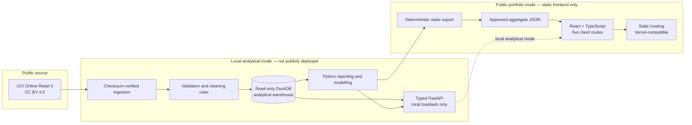
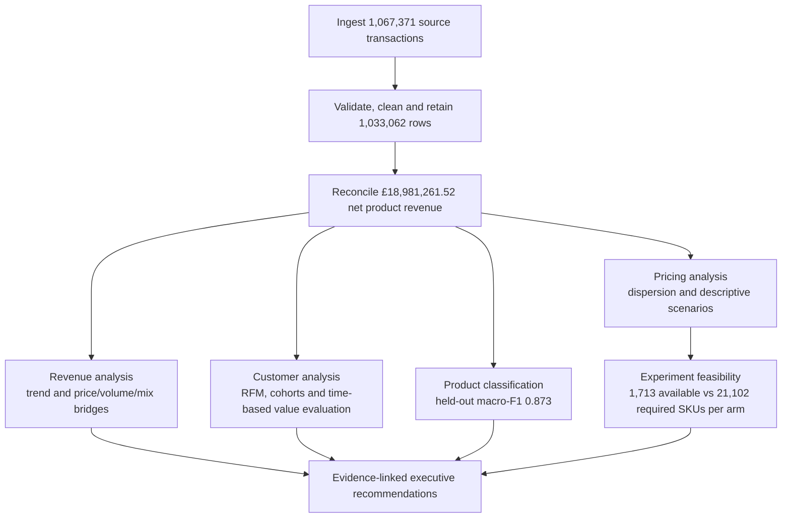
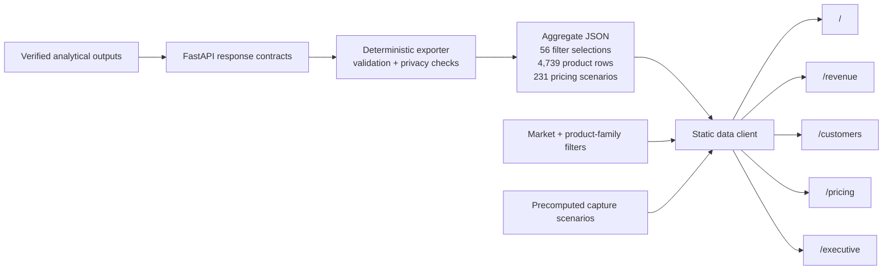

# Architecture

This project deliberately separates the complete local analytical system from the
aggregate-only public portfolio demo. The diagrams below describe the implemented
components; they do not imply a production data platform or a publicly hosted API.

## System architecture

The public path contains no FastAPI process, DuckDB file, raw transaction data,
customer-level records, invoice identifiers or internal development endpoint. The
frontend chooses either the local API client or the static data client at build time.

## Analytical pipeline

Customer value uses the historical-value baseline selected on a time-based holdout.
Pricing outputs are scenario ranges, not realised uplift or causal profit estimates.
The proposed experiment is not adequately powered to establish a 5% effect.

## Static demo flow

The snapshot is byte-reproducible and carries an analytical SHA-256 fingerprint.
Public interaction is limited to the exported market/family combinations, product
pages and pricing scenarios. Arbitrary date filtering remains disabled because it
would require publishing finer-grained data than the portfolio demo permits.
